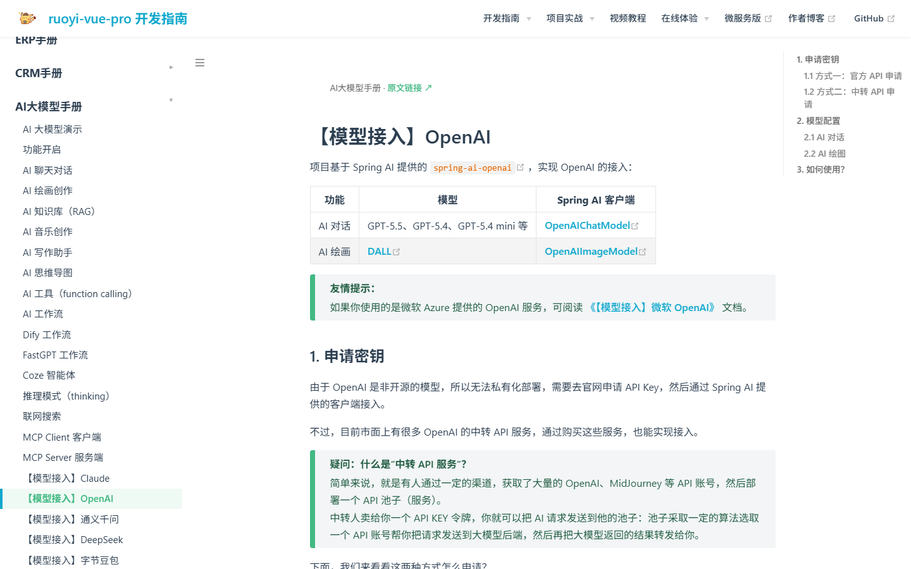

# 芋道源码文档 · 离线全站（单文件 HTML）

把 [doc.iocoder.cn](https://doc.iocoder.cn) 整站抓取下来后生成的**单文件离线文档站**，界面沿用原站（VuePress + Vdoing 主题）的样式，左侧为完整目录树，右侧为页内大纲，顶部为原站导航栏。

## 使用方法

**不需要“启动项目”**，这是一个单文件网页，直接看就行：

| 方式 | 操作 | 地址 |
|---|---|---|
| 最简单 | 双击 `index.html`（或双击 `打开文档.bat`） | `file:///…/yudao-docs-offline/index.html` |
| 起本地服务（可选） | 双击 `本地服务器.bat` | `http://127.0.0.1:8899/` |

如果双击后打开的是记事本等其它程序：右键 `index.html` →「打开方式」→ 选 Chrome / Edge。
首次打开白屏 1～2 秒属正常（12 MB 单文件需要解析），之后切页是瞬时的。

进入后：

- 左侧目录：点击分组标题（如「CRM手册」）可展开／收起；点击条目切换文档
- 顶部搜索框：按标题或路径过滤目录（快捷键 `/` 聚焦，`Esc` 清空）
- 右侧：当前页的二级／三级标题大纲，点击跳转
- 每页顶部：面包屑 + 「原文链接 ↗」（跳转原站）
- 每页底部：上一篇 / 下一篇
- 地址栏 `#/crm/build/` 这种 hash 可直接分享、可前进后退

## 收录范围

共 **391 篇**文档，覆盖原站侧边栏的全部 27 个栏目：

| 栏目 | 篇数 | 栏目 | 篇数 |
|---|---:|---|---:|
| AI 大模型手册 | 39 | WMS 手册 | 12 |
| 后端手册 | 36 | HRM 人力资源 | 12 |
| MES 手册 | 36 | OA 协同办公 | 12 |
| 商城手册 | 24 | 公众号手册 | 12 |
| IoT 物联网手册 | 24 | CRM 手册 | 11 |
| 萌新必读 | 18 | 前端手册 Vue 3.x | 11 |
| 工作流手册 | 17 | 支付手册 | 10 |
| 运维手册 | 14 | ERP 手册 | 10 |
| 更新日志 | 14 | FMS 财务管理 | 10 |
| 中间件手册 | 9 | IM 即时通讯 | 10 |
| 前端手册 Vben 5.x | 9 | 前端手册 Admin Uniapp | 9 |
| 会员手册 | 8 | PMS 项目管理 | 8 |
| 系统手册 | 7 | 前端手册 Vue 2.x | 7 |
| 大屏手册 | 2 | | |

## 说明与限制

- **图片仍是线上地址**（`doc.iocoder.cn/img/...`），想看图需要联网；正文、代码、表格全部离线可用。
- 文件约 12 MB，首次打开浏览器解析需要 1～2 秒，之后切换页面是瞬时的（内容已在内存中）。
- 原站侧边栏里有 5 个链接本身是死链（返回 404），未收录：
  `/vben5/component/`、`/admin-uniapp/component/`、`/erp/finance-payment-receipt/`、
  `/mall/seckill-combination/`、`/mall/seckill-bargain/`。
- 抓取时间为 2026-10-29，内容以当时的线上版本为准。

## 预览

